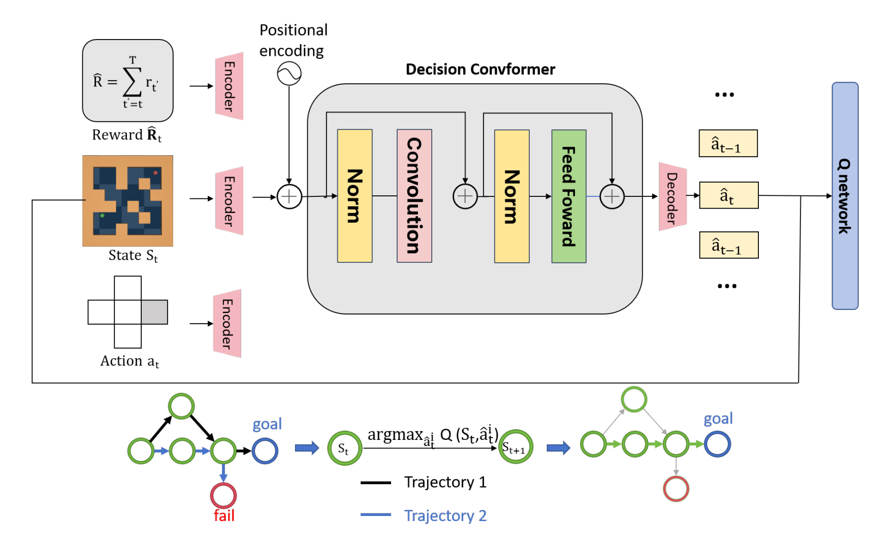

# QDC: Q-value Regularized Decision ConvFormer

Code for **[Q-value Regularized Decision ConvFormer for Offline Reinforcement Learning](https://arxiv.org/abs/2409.08062)**.

[Paper](https://arxiv.org/abs/2409.08062) · [中文](README.zh-CN.md) · [Setup](docs/installation.md)



QDC combines local convolutional trajectory modeling with Q-value regularization for offline reinforcement learning, evaluated on D4RL Gym, Maze2D, and Adroit tasks.

## Quick start

Use Python 3.10 and a suitable PyTorch build. See [setup](docs/installation.md) for the D4RL / MuJoCo dependencies.

```bash
python -m pip install -e .
python -m qdc.prepare_data --env hopper --dataset medium
python -m qdc.train --env hopper --dataset medium --seed 123 --eta 1.0
```

Existing datasets: `--data-dir D4RL` or `--data-file path.pkl`. Add `--eval-every 0` to train without a simulator. `--device auto` selects CUDA or CPU.

## Evaluation

```bash
python -m qdc.evaluate --checkpoint runs/your-run/best.pt --episodes 10
```

Runs save configuration, metrics, and checkpoints in `runs/`. Evaluation reports D4RL scores on the 0-100 scale.

## Experiments

```bash
python scripts/run_benchmark.py --suite gym --seeds 0 1 2 --dry-run
```

Remove `--dry-run` to launch. Suites: `gym`, `maze2d`, `adroit`. See [task presets](configs/benchmarks.json) and [implementation notes](docs/reproducibility.md). The presets have not been revalidated against the paper tables.

## Citation

[Q-value Regularized Decision ConvFormer for Offline Reinforcement Learning](https://arxiv.org/abs/2409.08062), arXiv:2409.08062, 2024. Citation metadata is available in [CITATION.cff](CITATION.cff).

## Acknowledgments

Adapted from [QT](https://github.com/charleshsc/QT) and [Decision ConvFormer](https://github.com/beanie00/Decision-ConvFormer). Licensed under [Apache-2.0](LICENSE); see [third-party notices](THIRD_PARTY_NOTICES.md).
