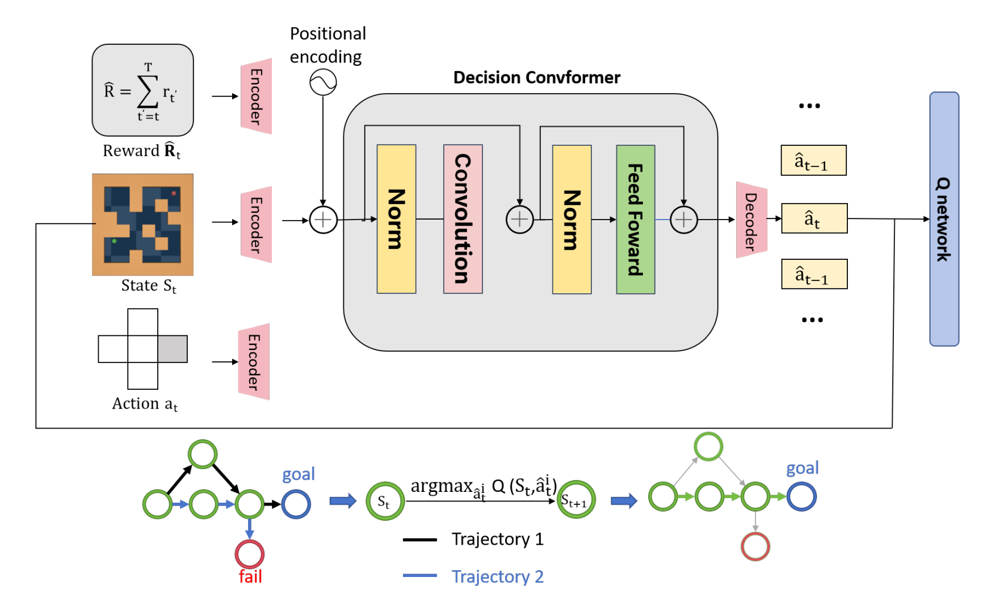

# QDC：Q-value Regularized Decision ConvFormer

论文 **[Q-value Regularized Decision ConvFormer for Offline Reinforcement Learning](https://arxiv.org/abs/2409.08062)** 的代码。

[论文](https://arxiv.org/abs/2409.08062) · [English](README.md) · [安装说明](docs/installation.md)



QDC 将局部卷积轨迹建模与 Q 值正则化结合，用于离线强化学习，覆盖 D4RL Gym、Maze2D 和 Adroit 任务。

## 快速开始

使用 Python 3.10 和适合硬件的 PyTorch；D4RL / MuJoCo 配置见[安装说明](docs/installation.md)。

```bash
python -m pip install -e .
python -m qdc.prepare_data --env hopper --dataset medium
python -m qdc.train --env hopper --dataset medium --seed 123 --eta 1.0
```

已有数据可用 `--data-dir D4RL` 或 `--data-file path.pkl` 指定。添加 `--eval-every 0` 可跳过仿真评估；`--device auto` 自动选择 CUDA 或 CPU。

## 评估

```bash
python -m qdc.evaluate --checkpoint runs/your-run/best.pt --episodes 10
```

配置、指标和权重保存在 `runs/`。评估报告 0–100 标度的 D4RL 得分。

## 批量实验

```bash
python scripts/run_benchmark.py --suite gym --seeds 0 1 2 --dry-run
```

去掉 `--dry-run` 即可运行；任务组支持 `gym`、`maze2d`、`adroit`。参数见[任务配置](configs/benchmarks.json)，差异见[实现说明](docs/reproducibility.md)。当前配置尚未重新验证论文表格成绩。

## 引用与致谢

[Q-value Regularized Decision ConvFormer for Offline Reinforcement Learning](https://arxiv.org/abs/2409.08062)，arXiv:2409.08062，2024。

实现基于 [QT](https://github.com/charleshsc/QT) 改造，并使用 [Decision ConvFormer](https://github.com/beanie00/Decision-ConvFormer) 的模型结构。项目采用 [Apache-2.0](LICENSE)，来源与许可见[第三方说明](THIRD_PARTY_NOTICES.md)。
